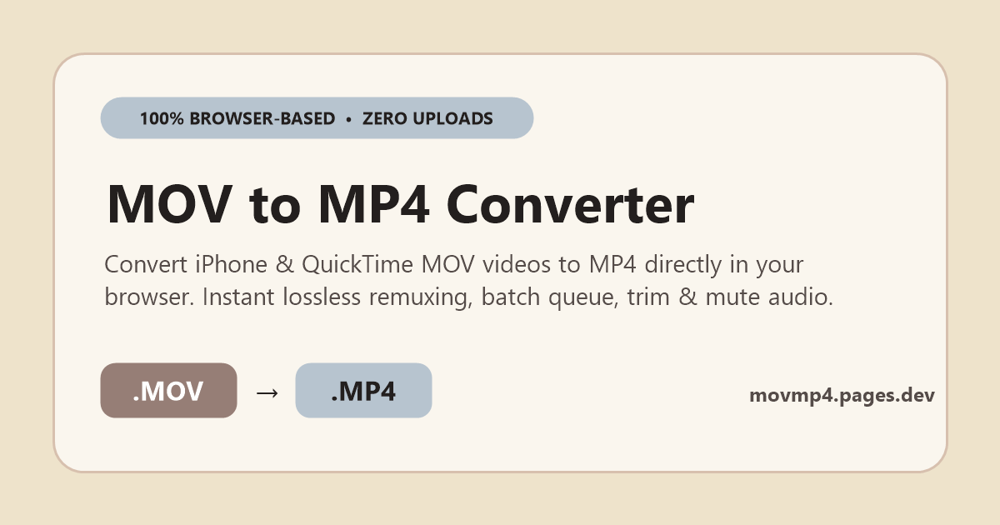

# MOV to MP4 Converter

[](https://movmp4.pages.dev)
[](https://astro.build)
[](https://www.typescriptlang.org/)
[](https://tailwindcss.com/)
[](https://pages.cloudflare.com/)
[](./LICENSE)

**A fast, ultra-minimal, 100% browser-based QuickTime `.mov` to `.mp4` converter with zero server uploads and no artificial 1 GB file limits.**

[Live App](https://movmp4.pages.dev) · [How to Use](https://movmp4.pages.dev/how-to-use) · [Hire Me](https://movmp4.pages.dev/hire-me) · [Buy Me a Coffee](https://kisharadilshan.gumroad.com/coffee)



---

## Overview

Traditional online video converters force users to upload large iPhone or QuickTime `.mov` clips to remote servers, wait in processing queues, and hit strict 500 MB–1 GB limits. **MOV to MP4 Converter** runs an isolated single-threaded FFmpeg WebAssembly engine directly inside the user's browser tab—keeping personal footage private and turning standard H.264/HEVC `.mov` videos into `.mp4` in roughly 1–2 seconds.

---

## Key Features

- **Instant Auto-Conversion UX:** Dropping or selecting `.mov` files immediately starts conversion with a smooth `.MOV → .MP4` stream animation and live progress indicator—no unnecessary extra clicks.
- **Collapsible `More Settings` + Toast Feedback:** Once ready to download, an optional collapsible **More Settings** panel lets users set `MM:SS` **Trim Start / End**, toggle **Mute Audio (`-an`)**, or pick **Quality / Resolution** (`Original`, `1080p`, `720p`, `480p`), displaying a `"Settings applied!"` toast confirmation on completion.
- **Smart Lossless Remuxing (`-c copy`):** Standard iPhone and QuickTime H.264/HEVC streams re-wrap into MP4 with `-movflags +faststart` and zero quality loss (including hybrid `-c:v copy -c:a aac` remuxing when only the audio track—such as PCM—needs conversion).
- **Automatic Compatibility Transcoding:** Automatically falls back to `libx264 -preset ultrafast` + `aac` when converting Apple ProRes, incompatible codecs, trimmed clips, or resized resolutions (with aspect-ratio and even-dimension clamping).
- **Zero-Server Memory Mounting (`WORKERFS`):** Mounts browser `File` objects directly inside the FFmpeg Web Worker via Emscripten `WORKERFS`, avoiding upfront full-file RAM duplication.
- **Batch Queue Support:** Drop multiple `.mov` files together to auto-convert sequentially with per-file progress bars, individual **Download MP4** links, and a **Download All MP4s** action.
- **Clean Responsive Navigation:** Desktop navbar displays core items (`How to Use`, `Hire Me`, direct `Support the Developer` link) plus a utility toggle popover for **Light / Dark theme**, **8-language selector**, and **GitHub**; mobile/tablet renders `44x44px` accessible icon buttons.
- **8-Language Internationalization:** Complete client-side dictionary switching with 100% key parity across 8 languages while preserving English static HTML for search engines.

---

## How the Conversion Pipeline Works

| Scenario | FFmpeg Strategy | Result |
| :--- | :--- | :--- |
| **Standard iPhone / QuickTime H.264 or HEVC** (`Original`, no trim) | `-map 0:v:0 -map 0:a:0? -c copy -dn -sn -movflags +faststart` | Instant ~1–2s lossless container remux |
| **H.264/HEVC Video + Uncompressed PCM Audio** (`Original`, no trim) | `-c:v copy -c:a aac -b:a 192k` hybrid fallback | Lossless video + universal AAC audio |
| **Mute Audio Only** (`Original`, no trim) | `-map 0:v:0 -an -c:v copy -dn -sn` | Instant lossless video with audio stripped |
| **Trim (`MM:SS`), Scaling (`1080p`/`720p`/`480p`), or ProRes** | `-c:v libx264 -preset ultrafast -crf 23 -pix_fmt yuv420p` + `aac` | Universally playable MP4 for Windows, Android, Discord & Web |

> **Cloudflare Pages 25 MiB Asset Compliance:** Because `@ffmpeg/core`'s `ffmpeg-core.wasm` binary is ~30.74 MiB, `scripts/prepare-ffmpeg.mjs` runs automatically during `predev` / `prebuild` to split it into `< 16 MiB` chunks (`public/ffmpeg/ffmpeg-core.wasm.part0` and `part1`). The browser stitches them into a same-origin `Blob` URL on demand and falls back to jsDelivr CDN if local chunks are unavailable.

---

## Color System (Light & Dark Modes)

| Token | Light Mode (Default) | Dark Mode |
| :--- | :--- | :--- |
| **Page Background** | `#EEE3CB` (Warm Cream) | `#1E2226` |
| **Card Surface** | `#FAF6EE` | `#272C31` |
| **Dropzone Accent** | `#B7C4CF` (Cool Slate Mist) | `#343B42` |
| **Borders & Secondary** | `#D7C0AE` (Soft Clay) | `#967E76` |
| **Primary Action** | `#967E76` (Warm Taupe + `#FFFFFF` text) | `#B7C4CF` (`#1E2226` text) |
| **Primary Text** | `#231F1E` | `#EEE3CB` |

---

## Supported Languages (100% Key Parity)

| Code | Language | Dictionary |
| :--- | :--- | :--- |
| `en` | English (Default) | [src/i18n/locales/en.json](./src/i18n/locales/en.json) |
| `es` | Español | [src/i18n/locales/es.json](./src/i18n/locales/es.json) |
| `pt` | Português | [src/i18n/locales/pt.json](./src/i18n/locales/pt.json) |
| `de` | Deutsch | [src/i18n/locales/de.json](./src/i18n/locales/de.json) |
| `fr` | Français | [src/i18n/locales/fr.json](./src/i18n/locales/fr.json) |
| `ja` | 日本語 | [src/i18n/locales/ja.json](./src/i18n/locales/ja.json) |
| `zh` | 简体中文 | [src/i18n/locales/zh.json](./src/i18n/locales/zh.json) |
| `ru` | Русский | [src/i18n/locales/ru.json](./src/i18n/locales/ru.json) |

---

## Project Structure

```text
movmp4/
├── .github/
│   └── FUNDING.yml                 # GitHub Sponsors / Gumroad coffee link
├── public/
│   ├── _headers                    # Cloudflare Pages security & asset cache headers
│   ├── _redirects                  # Canonical & trailing-slash normalization
│   ├── favicon.svg                 # Brand vector icon
│   ├── og-image.png                # Social share preview card (1200x630)
│   └── robots.txt                  # Explicit /sitemap.xml directive
├── scripts/
│   ├── prepare-ffmpeg.mjs          # Prepares & splits @ffmpeg/core WASM (< 16 MiB chunks)
│   └── verify-i18n.mjs             # Verifies 100% translation key parity across 8 locales
├── src/
│   ├── components/
│   │   ├── CopyEmailButton.tsx     # Interactive email copy button on /hire-me
│   │   ├── Footer.astro            # Minimal semantic footer
│   │   ├── MovToMp4Tool.tsx        # Main client:load focal MOV -> MP4 converter island
│   │   └── Navbar.tsx              # Desktop & 44x44px mobile/tablet navbar + toggle popover
│   ├── i18n/
│   │   ├── index.ts                # Lazy locale loader, React hook & DOM translator
│   │   ├── verify-types.ts         # Compile-time dictionary parity guard
│   │   └── locales/                # Synchronized JSON dictionaries (en, es, pt, de, fr, ja, zh, ru)
│   ├── layouts/
│   │   └── BaseLayout.astro        # SEO metadata, OG/Twitter tags, GTM/GA4, theme init & JSON-LD
│   ├── lib/
│   │   ├── theme.ts                # Light/Dark theme persistence & event bus
│   │   └── video/
│   │       ├── converter.ts        # WORKERFS mount, remux/transcode & sequential queue engine
│   │       ├── ffmpeg-loader.ts    # Lazy single-threaded FFmpeg loader with CDN fallback
│   │       ├── index.ts            # Public video engine exports
│   │       ├── time.ts             # MM:SS validation, size formatting & filename helpers
│   │       └── types.ts            # TypeScript engine contracts
│   ├── pages/
│   │   ├── index.astro             # Home focal converter, Helpful Content & FAQPage JSON-LD
│   │   ├── how-to-use.astro        # Step-by-step guide with BreadcrumbList JSON-LD
│   │   ├── hire-me.astro           # Freelance inquiry page with BreadcrumbList JSON-LD
│   │   └── sitemap.xml.ts          # Flat GSC-friendly XML sitemap endpoint
│   └── styles/
│       └── global.css              # Tailwind CSS v4 tokens & GPU-accelerated animations
├── astro.config.mjs
├── package.json
└── tsconfig.json
```

---

## Local Development

### Prerequisites

- **Node.js** 18+ (verified on Node 24)
- **npm** 9+

### Install & Run

```bash
# 1. Clone the repository
git clone https://github.com/Kishara007/movmp4.git
cd movmp4

# 2. Install dependencies
npm install

# 3. Start local dev server (runs predev to prepare local FFmpeg WASM chunks)
npm run dev
```

### Checks & Production Build

```bash
# Verify 100% 8-language translation key parity
node scripts/verify-i18n.mjs

# Run strict Astro & TypeScript diagnostics
npm run typecheck

# Build static production output into dist/
npm run build

# Preview production build locally
npm run preview
```

---

## Deployment (Cloudflare Pages)

This project builds static files into `dist/` and deploys via Wrangler Direct Upload:

```bash
# Build and deploy directly to Cloudflare Pages
npm run deploy
```

Or run the build and Wrangler command separately:

```bash
npm run build
npx wrangler pages deploy dist --project-name=movmp4 --branch=main
```

---

## Author & Support

- **Developer:** Kishara Dilshan
- **Email:** [kisharadilshan007@gmail.com](mailto:kisharadilshan007@gmail.com)
- **Support the Project:** [https://kisharadilshan.gumroad.com/coffee](https://kisharadilshan.gumroad.com/coffee)
- **Repository:** [https://github.com/Kishara007/movmp4](https://github.com/Kishara007/movmp4)

Licensed under the [MIT License](./LICENSE).
